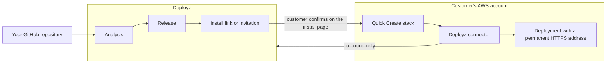

{/* Last checked against deployz commit 0c21c52e on 2026-10-21 */}

Three parties take part in every deployment: you (the vendor), Deployz, and your customer's AWS account. You prepare and operate the application in the Deployz dashboard. Your customer approves one setup step in their AWS account. After that, the Deployz connector inside the customer's account does the work there, and it always connects out to Deployz, never the other way around.

## From repository to running deployment

In short: Deployz reads your GitHub repository, analyzes it, and builds releases. You send your customer an install link or an invitation. Your customer creates the Deployz connector in their AWS account, and the connector installs the release there while it reports back to Deployz.

1. **You connect a repository.** You install the Deployz GitHub App and choose a repository. Deployz requests read-only access to your code.
2. **Deployz analyzes it.** Analysis reads the repository and detects what the application needs, such as its port, health check, environment variables, database, and cache. It tells you what to change if something doesn't fit. See [Application requirements](/prepare/requirements).
3. **You create a release.** Deployz builds a commit into a release, a fixed version of your application. Creating a release doesn't change any deployment. See [Create a release](/releases/create).
4. **You test it, then share it.** You run a free [test deployment](/share/test-deployment) in your own AWS account. Then you share an [install link](/share/install-links) or send a customer an [invitation](/share/invitations). Your customer can confirm an install only while your organization has an active subscription. See [Pricing and billing](/account/billing).
5. **Your customer reviews and confirms the install.** On the install page, your customer:
   1. Chooses an AWS Region and a size. The page shows what will be created and the estimated monthly AWS cost.
   2. Enters any **Application settings** you asked them to provide.
   3. Enters their name and email under **Your details**. Only an install link asks for these, because an invitation already names the customer.
   4. Selects **Continue to setup**, then **Connect AWS account**. A CloudFormation Quick Create page opens in their AWS console. Nothing is created in their account until they approve it there.
6. **The Deployz connector sets up the application.** The Quick Create stack creates the Deployz connector in the customer's account. The connector checks in with Deployz and has AWS CloudFormation create the application's infrastructure. It then starts your newest ready release.
7. **The deployment goes live.** Deployz checks that the application is healthy and gives it a permanent address in the form `https://d-<deployment-id>.deployz.dev`, where `<deployment-id>` is the deployment's ID. You can add a [custom domain](/operate/custom-domains) later.
8. **You operate it from the dashboard.** When you deploy an update, roll back, restart, or change configuration, the connector picks up the request on its next check-in and carries it out in the customer's account.

For the customer's side of steps 5 to 7, see [Install the application](/customers/install).

## What runs where

| Where | What runs or is stored there |
| --- | --- |
| Deployz | Your dashboard, the install pages your customers open, repository analysis, release builds, and the status of every deployment. Deployz also stores the configuration values you set, encrypting your secret values, and the non-secret values your customers enter. A secret entered for one customer stays in Deployz only until Deployz delivers it to AWS Secrets Manager in that customer's account. Encrypted backup copies can remain for up to 7 days. See [Secrets you enter](/customers/security#secrets-you-enter). |
| The customer's AWS account | The Deployz connector, your application, and its network, database, cache, and file storage |
| Your GitHub account | Your source code. Deployz reads it with the access you grant to the GitHub App. |

Each deployment is one application in one AWS Region of one customer's account. Your customer owns that account, its data, and its AWS charges. For the resources a deployment creates, see [AWS resources Deployz creates](/reference/aws-resources).

## The Deployz connector

The Deployz connector is a small AWS Lambda function that the customer's Quick Create stack creates in their AWS account, together with its roles. It's how Deployz makes changes in that account.

- **It runs every minute.** Each run checks in with Deployz over HTTPS, collects any pending command, such as install, update, or remove, carries it out, and reports the result.
- **It connects outbound only.** Deployz has no inbound path into the customer's account. While the connector is offline, Deployz can't make changes there. If the customer deletes the connector stack, Deployz can't reconnect, and can't change or remove the application.
- **It works through two roles.** The connector makes some changes with its own role. For the application's infrastructure, it asks AWS CloudFormation to apply the application stack with a separate execution role from the same connector stack.
- **It's limited to one deployment.** Each change these roles can make is limited to this deployment's resources, by tag or by name. Read-only actions and a few other actions can't be limited this way. [Security and AWS access](/customers/security#iam-roles-and-permissions) lists exactly what each role can do.

To reconnect or update a connector, see [Reconnect or update the Deployz connector](/operate/connector).

## Deployz never holds customer AWS credentials

Deployz never asks for AWS access keys or administrator credentials, from you or your customer. The customer approves the Quick Create stack in their own AWS console, with their own sign-in. From then on, the connector acts inside the account with the permissions that stack gave it.

The connector sends Deployz operational information, such as deployment state, health status, resource identifiers, and AWS error messages. Your customer's database data, file storage, cache contents, and application logs stay in their account. [Security and AWS access](/customers/security) has the full list of what Deployz receives and doesn't receive. It's written for your customer's security reviewer, so you can send it to them.

Traffic to the default `deployz.dev` address passes through the Deployz Cloudflare network. Traffic to a custom domain goes directly to the load balancer in the customer's account. See [Application traffic](/customers/security#application-traffic).
